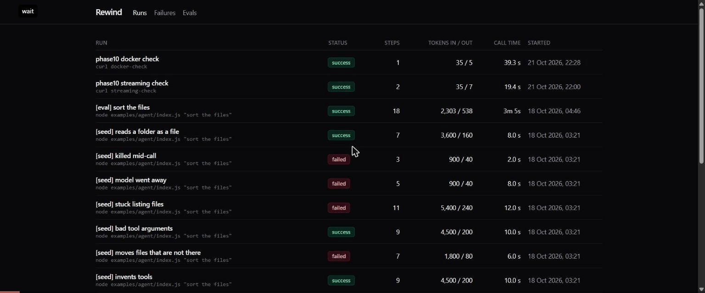
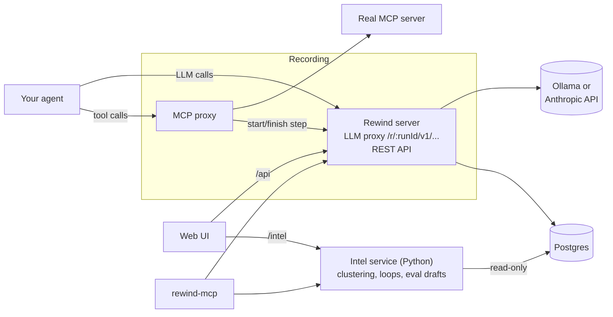

# Rewind

**A time-travel debugger for AI agents.** Rewind records every LLM call and tool call an agent makes, lets you replay a run step by step, and lets you **fork** it at any step: change a tool result, a prompt or the model, and see what the agent would have done instead.

**[Live demo](https://matloobf.github.io/Rewind/)** (a read-only snapshot of recorded runs) · [Design decisions](DECISIONS.md) · [Recording Claude Code](#recording-claude-code)



## Why

Agent runs are long and non-deterministic. When an agent goes wrong at step 14, the logs tell you *what* happened but not *why*, and re-running it gives you a different run. Rewind keeps the whole run, lets you look at exactly what the model saw at each step, and lets you re-run from any step with one thing changed while everything before it is replayed exactly.

## Features

- **Recording proxy for LLM calls.** OpenAI-compatible (`/v1/chat/completions`) and Anthropic (`/v1/messages`) formats, streaming or not. An agent is recorded by changing only its base URL.
- **Recording proxy for tools.** Wraps any stdio MCP server and records each tool call, including errors a tool reports with `isError`.
- **Step timeline.** Every LLM and tool step in order, showing only the messages that are new at each LLM step, with tokens, latency and raw JSON.
- **Fork at any step.** Edit a step's response or its request. Steps before it are replayed from the recording (no LLM or tool calls), the edited step runs, and everything after runs live. If the agent sends a different request than the recorded one, Rewind marks where it diverged and goes live from there.
- **Branch graph and run diff.** See a run's forks as a tree, and compare two runs step by step.
- **Failure patterns.** A Python service groups error messages across runs by meaning (sentence embeddings + HDBSCAN) and flags runs stuck in a loop.
- **Regression evals.** Turn a run into an eval with structured assertions (`must_not_call_tool`, `max_steps`, `final_output_contains`, ...) checked by plain code, not by an LLM. Run them with `rewind eval`.
- **Rewind as an MCP server.** Ask Claude Code or Cursor about your runs, failure patterns and evals.
- **Free to run.** Ollama for the LLM and local embeddings by default; paid APIs are optional.

## Architecture



A few ideas hold it together:

- **The run id is in the URL.** The LLM proxy lives at `/r/:runId/v1/...`, so recording needs no SDK and no code changes: `rewind run` creates a run and hands the agent a base URL that contains its id.
- **The proxy is transparent.** Requests and responses pass through unchanged, status codes included. Recording never changes what the agent sees.
- **One step sequence, one owner of writes.** LLM and tool steps share one numbering. Both proxies record through the same "start step / finish step" API, and the server decides there, in one place, whether a step is live, replayed or overridden. The Python service only reads.

Stack: Node (Express, `pg`, MCP SDK), React (Vite, Tailwind, React Query, React Flow, Monaco), Python (FastAPI, sentence-transformers, scikit-learn), PostgreSQL 16.

## Quick start

You need [Ollama](https://ollama.com) on the host either way:

```bash
ollama pull qwen2.5:7b
ollama create rewind-qwen -f examples/agent/Modelfile   # qwen2.5:7b with a 16k context
```

### With Docker

```bash
docker compose --profile app up -d --build
```

Open http://localhost:8080. This starts Postgres, the server (proxy + API on :4000, migrations run on start), the intel service (:8000) and the web UI (nginx on :8080). Plain `docker compose up -d` starts only Postgres, for local development.

Two things to know: the intel image is about 2.2 GB (CPU-only PyTorch plus the embedding model, baked in so it starts offline), and **forks and evals need the server running on the host**, because they re-launch the agent in its original working directory, which doesn't exist inside a container.

### For development

```bash
docker compose up -d                                   # Postgres
cd server && npm install && npm run migrate && npm run dev     # :4000
cd intel && python -m venv .venv && .venv/Scripts/python -m pip install -r requirements.txt
cd intel && .venv/Scripts/python -m uvicorn main:app --port 8000   # .venv/bin/python on macOS/Linux
cd web && npm install && npm run dev                   # http://localhost:5173
cd server && npm link                                  # installs the `rewind` command
```

Copy `.env.example` to `.env` first. The full command list is in [CLAUDE.md](CLAUDE.md#commands).

Then record the sample agent, a small file organizer that only touches `examples/agent/sandbox`:

```bash
cd examples/agent && npm install && npm run seed
rewind run --name "first run" -- node examples/agent/index.js "sort the files"
```

On a CPU, one run takes about 3 minutes. It shows up in the web UI as it records.

## Record your own agent

```bash
rewind run --name "my run" -- <your agent command>
```

`rewind run` creates a run, starts your command (no shell) and sets:

| Variable | Use it as |
|---|---|
| `REWIND_BASE_URL` | the base URL for an OpenAI-compatible SDK (`.../r/<id>/v1`) |
| `ANTHROPIC_BASE_URL` | picked up by Anthropic SDKs and Claude Code (`.../r/<id>`) |
| `REWIND_RUN_ID` | read by the MCP proxy |

To record tool calls, launch your MCP server through the proxy:

```bash
node mcp-proxy/index.js -- <your MCP server command> [args...]
```

Notes on what gets recorded:

- Responses are always stored in the non-streaming shape, even when the call streamed; the stream itself is forwarded to the agent as it arrives.
- API keys are forwarded upstream but never stored.
- Other routes under `/r/:runId/v1/` (such as Anthropic's `count_tokens`) are passed through without being recorded.

## Recording Claude Code

Claude Code reads `ANTHROPIC_BASE_URL`, so `rewind run` records its LLM calls with no changes. Its prompt is too large for a 7B model on a CPU, so this uses the real Anthropic API (paid): set `ANTHROPIC_UPSTREAM_URL=https://api.anthropic.com` in `.env` and restart the server.

To record its tool calls as well, give it the file tools through the MCP proxy and turn its built-in tools off. Save this as `claude-mcp.json`:

```json
{ "mcpServers": { "files": { "command": "node",
  "args": ["mcp-proxy/index.js", "--", "node", "examples/agent/mcp-server.js"] } } }
```

```bash
rewind run --name "claude code" -- claude --bare -p "Sort the files in the sandbox into folders by type" \
  --tools "" --mcp-config claude-mcp.json --strict-mcp-config --allowedTools mcp__files
```

`--bare` keeps your `CLAUDE.md`, memory and hooks out of the recording (it needs `ANTHROPIC_API_KEY` set). This recipe hasn't been run end to end yet, since it needs a paid API key: the pieces it relies on (`ANTHROPIC_BASE_URL`, the Anthropic route with streaming, side-route passthrough, the MCP proxy) are each tested, but not this exact command. Cursor's own LLM calls go through Cursor's servers and can't be proxied, but its MCP tool calls can be recorded the same way.

## Ask Rewind from Claude Code or Cursor

`rewind-mcp` exposes Rewind as a read-only MCP server with six tools: `list_runs`, `get_run`, `get_failure_patterns`, `get_run_loops`, `list_evals` and `get_eval`. The repo commits `.mcp.json` (Claude Code) and `.cursor/mcp.json` (Cursor), so opening the repo offers to enable it. Then ask things like *"Why did the last run fail?"* or *"What are the most common failures?"*

## Tests

| Package | Command | Tests | Needs |
|---|---|---|---|
| server | `npm test` | 140 | Postgres (fake LLM upstreams) |
| web | `npm test` | 28 | nothing |
| mcp-proxy | `npm test` | 28 | nothing |
| rewind-mcp | `npm test` | 36 | nothing |
| examples/agent | `npm test` | 50 | nothing |
| intel | `.venv/Scripts/python -m pytest` | 44 | Postgres |

The replay engine has the most coverage: passthrough in record mode, replay before the fork, override at the fork, live after it, divergence and the off-by-one cases.

## Limitations

- **Agents are assumed to be sequential:** one LLM or tool call at a time. Parallel calls would break the step numbering.
- **Replayed tool steps don't run.** A fork's optional setup command resets the world to the start of the run, not to its state at the fork step, so forking after a file-changing tool call starts from the wrong state.
- **Agents whose requests change between runs diverge early.** Claude Code puts the date and a session id in its prompt, so a fork of a Claude Code run probably goes live from the first step.
- **No auth.** Rewind is meant for local use; the public demo is a static snapshot, not a live server.
- **Ollama on a CPU is slow,** about 3 minutes for one sample run.

## Repository layout

```
server/        LLM proxy, REST API, replay engine, `rewind` CLI, SQL migrations
mcp-proxy/     MCP proxy that records tool calls
rewind-mcp/    Rewind as an MCP server
intel/         Python service: failure clustering, loop detection, eval drafts
web/           React UI; `npm run build:demo` builds the GitHub Pages demo
examples/agent/  Sample file-organizer agent and its sandbox
```

Every significant choice, with the reason and the alternative rejected, is in [DECISIONS.md](DECISIONS.md).

## License

[MIT](LICENSE)
